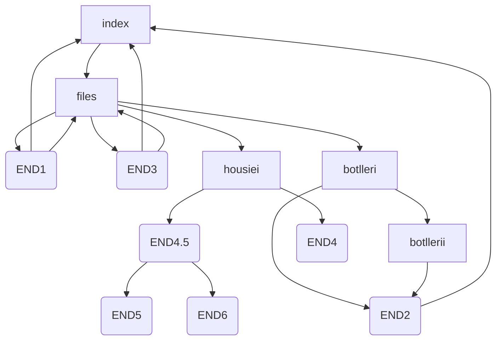

# Detective Flowers
A choice-driven, mystery text game written in HTML and CSS!

Lady Welthie has hired you, Detective Flowers, to catch the thief behind her stolen jewellery. But there's only a few people who work for her, and she trusts them all closely. Do you have what it takes to figure it out?

**Play at: https://rgbhsl.github.io/detective-flowers/**

## Features
- 6 unique endings, and a fake-out ending
- 10+ pages
- Multiple sections with simple CSS formatting

## How it works

- Entirely made with HTML and CSS, with the written sections being fully original.
- The user picks from the choices to navigate the story, automating the process of flipping pages in a physical interactive novel. 

- Website layout map: 

## Why I made this
I've always really liked interactive novels, the kind where you read a page and at the bottom they tell you to flip to a diffferent page based on your choice, or to go to a page to continue your current storyline. I thought it'd be interesting to write a digital version of that. And I thought it would be even more interesting to have said digital version set a while back in the past, as a twist. 
HTML I'm quite familiar with, CSS I struggle with to some extent.
I worked quite hard on the storyline. I orignally wanted to give it way more endings (at least 10) and longer storylines. But I don't want to work on this much longer since I've begun to prefer Python for choice-based text games. Maybe I'll fix this up in the future but I want to leave it be for now.

## Acknowledgements
- Images taken from free assets on Canva
- W3Schools for help with the navbar (no copy paste)
- Github Documentation, and Mermaid Tutorials for instructions on making a Mermaid diagram
- Used Stardance Missions documentation for help with the JavaScript
- Inspired by interactive fiction novels, where you flip to a specific page after making a choice

No AI was used to write any part of the story or code. 
